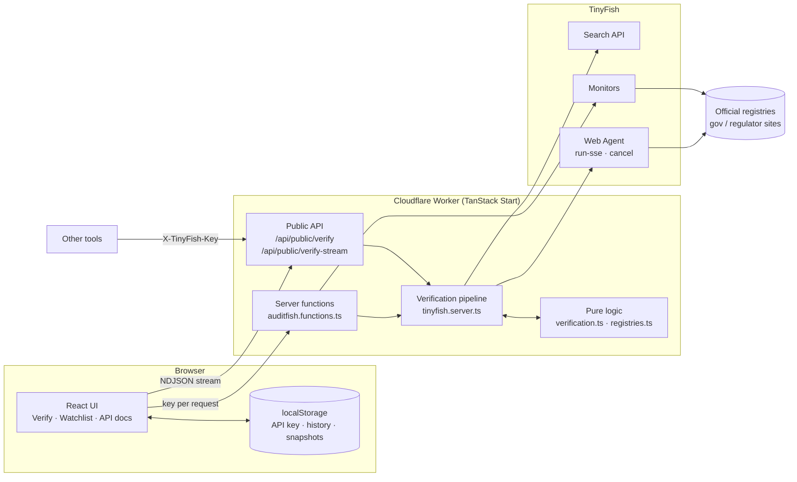
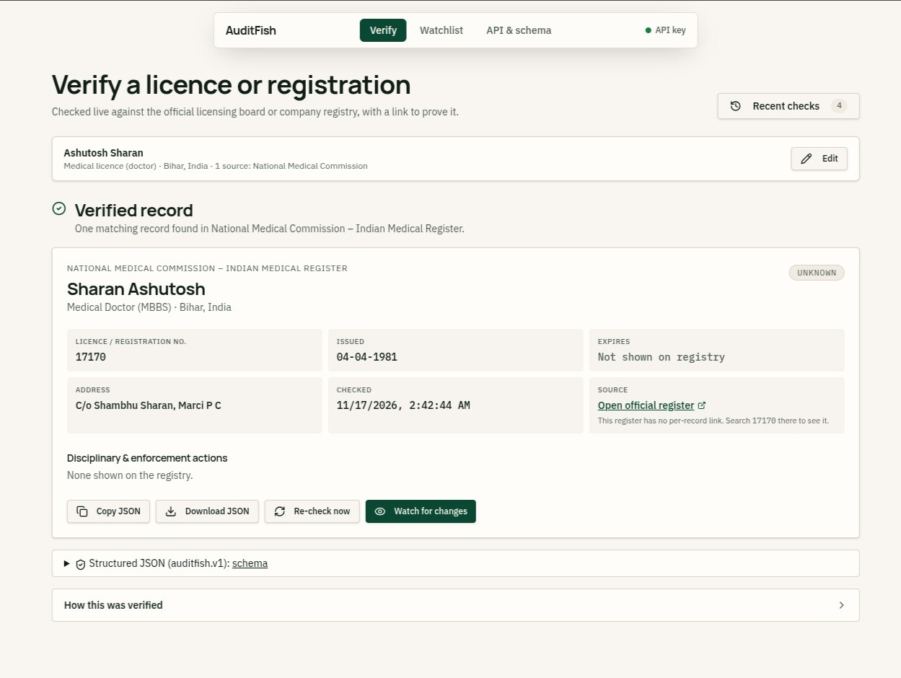
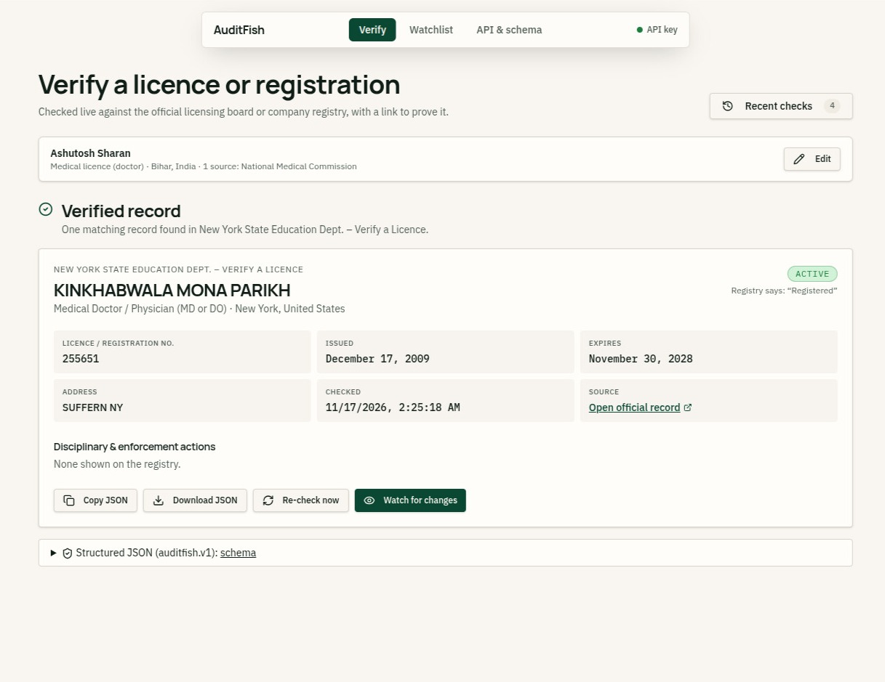

<p align="center">
  
</p>

<h1 align="center">AuditFish</h1>

<p align="center">
  Verify that a person or business is licensed, straight from the official registry, with proof.
</p>

<p align="center">
  
  
  
  
  
  
  
  
</p>

## Project summary

Checking whether a doctor, nurse, lawyer, contractor or company is really licensed means finding
the right government register, working through its search form and reading the result by hand.
Every register looks different, and most have no API.

AuditFish does this for you. You type a name, a record type and a place. A TinyFish browser agent
then searches the official licensing board or company registry, just as a person would. You get back
a structured `auditfish.v1` result with the status, licence number, issue and expiry dates,
disciplinary actions, a link to the source and the time of the check.

- **Official sources only.** Results come from government and statutory-regulator domains, never
  from aggregator sites.
- **Never guesses.** If several entries could be the person, AuditFish lists them for you to pick
  from. It never auto-picks one.
- **Watch for changes.** A verified record can be watched daily, and changes to status, number,
  expiry or disciplinary actions are shown as a before/after diff.
- **Bring your own key (BYOK).** Your TinyFish API key stays in your browser's `localStorage` and is
  sent with each request. AuditFish has no accounts and no database, and it never stores the key.
- **API for other tools.** The same pipeline is available as a JSON or streaming HTTP API.

## How TinyFish is used

All TinyFish calls go through one server-only module, `src/lib/tinyfish.server.ts`, and use the
caller's own key in the `X-API-Key` header.

| TinyFish API | Endpoint | What AuditFish uses it for |
| --- | --- | --- |
| **Search** | `GET api.search.tinyfish.ai?query=…` | **Source discovery.** Finds the official register for a place and record type, e.g. "Bihar medical council register search India", to add to the built-in list. Results are kept only if they are on an official domain. Documents, manuals, notices and sign-up pages are dropped, and search/register pages are ranked first. |
| **Web Agent (SSE)** | `POST agent.tinyfish.ai/v1/automation/run-sse` | **The registry lookup.** Each run gets the register URL, a step-by-step goal and a JSON `output_schema` (`page_state`, `searches_tried`, `candidates`, `record`). Runs use the stealth browser and `agent_config.max_duration_seconds`, so a slow register still returns what the agent found. Stream events drive the live UI: `STREAMING_URL` gives the live browser view, `PROGRESS` feeds the step timeline and the loop guard, and `COMPLETE` carries the result. |
| **Cancel run** | `POST agent.tinyfish.ai/v1/runs/{id}/cancel` | Stops a run when you click "Skip this registry", when the agent repeats the same action over and over (a broken form), or when you close the check. The pipeline then moves on to the next official source. |
| **Monitors: create** | `POST agent.tinyfish.ai/v1/monitors` | "Watch for changes" creates a daily (`0 9 * * *`) `fetch` monitor on the record's page, named with the `AuditFish` prefix. Its `purpose` tells TinyFish which changes matter. |
| **Monitors: list** | `GET agent.tinyfish.ai/v1/monitors` | The Watchlist page. TinyFish Monitors are the source of truth for what is being watched. |
| **Monitors: run now** | `POST agent.tinyfish.ai/v1/monitors/{id}/runs` | "Check now": returns `changed`, `unchanged` or `baseline`, the page diff and TinyFish's judgement of whether the change is relevant. |
| **Monitors: update** | `PATCH agent.tinyfish.ai/v1/monitors/{id}` | Pause or resume a watch. |
| **Monitors: delete** | `DELETE agent.tinyfish.ai/v1/monitors/{id}` | Stop watching a record. |

## How it works

1. **Ask.** Enter a name, a record type (medical, nursing, lawyer, contractor, company or other), a
   country, an optional state or region, and an optional licence number.
2. **Find sources.** Built-in registries for that place (`src/lib/registries.ts`) come first. TinyFish
   Search then adds other official registers it finds. You can review the list before running.
3. **Look up.** For each source (up to two), a TinyFish agent opens the register and sets the
   state/council and profession filters. It searches by number or name and retries with name
   variants: the reversed name, the surname only, the first name only. It returns every result row,
   plus the detail record if exactly one row fits. You can watch the browser live and see each step
   as it happens.
4. **Decide.** Matching is pure, tested code in `src/lib/verification.ts`. Names are compared in any
   order, with titles, initials and common spelling variants allowed. Rows with a clearly different
   profession are set aside, e.g. nurses on a doctor search.
   - Exactly one confirmed match → **Verified record**.
   - Several matches, or a near-name match → **Several possible matches**, for you to pick from.
     AuditFish then opens the one you pick.
   - Nothing → **No matching record**, with the exact searches that were run.
   - The register could not be searched → **Source could not be checked**, with the reason.
5. **Prove.** The result links to the record's own page when the register has one, otherwise to the
   search page with the number to look up. It can be copied or downloaded as `auditfish.v1` JSON.
6. **Watch.** "Watch for changes" creates a TinyFish Monitor and saves a local snapshot of the record.
   A later check is compared field by field with that snapshot.

## High-level architecture



- **Frontend** (`src/routes/index.tsx`, `src/routes/watchlist.tsx`, `src/components/auditfish/`):
  the verify form, live agent view and step timeline, record card, and watchlist. The key, recent
  checks and watch snapshots stay in the browser.
- **Server** (`src/lib/tinyfish.server.ts`): source discovery, the agent run with its time, step and
  loop guards, and result building. The streaming UI route and the JSON API share this pipeline, so
  both return identical `auditfish.v1` results.
- **Pure logic** (`src/lib/verification.ts`): status normalisation, name and licence-type matching,
  official-domain checks, source ranking and record diffs, all covered by Vitest.
- **Hosting:** a single Cloudflare Worker on the free plan. It needs no KV, D1 or secrets.

## Project setup

**Requirements:** Node.js 22+ (24 recommended, see `.node-version`), npm and a TinyFish API key.

```sh
git clone https://github.com/GxAditya/auditfish.git
cd auditfish
npm ci                 # installs exactly what package-lock.json lists
npm run dev            # http://localhost:8080
```

Open the app, click **API key** and paste your TinyFish key. It is saved only in your browser.

| Task | Command |
| --- | --- |
| Tests | `npx vitest run` |
| Typecheck | `npx tsc --noEmit` |
| Production build | `npx vite build` |
| Local Worker preview | `npm run cf:dev` |
| Deploy from your machine | `npx wrangler login` (once), then `npm run deploy` |

The Worker config is `wrangler.jsonc`. `.npmrc` skips package versions published less than a day ago,
as a supply-chain guard.

### Deploy on Cloudflare (free plan, GitHub connect)

AuditFish runs as a single Worker. It needs no KV, D1, R2, secrets or environment variables, because
each user brings their own TinyFish key.

1. Push the repo to GitHub (`GxAditya/auditfish`).
2. In the Cloudflare dashboard, go to **Workers & Pages** → **Create** → **Import a repository**, and
   choose the repo.
3. Use these settings:

   | Setting | Value |
   | --- | --- |
   | Project / Worker name | `auditfish` (must match `name` in `wrangler.jsonc`) |
   | Production branch | `main` |
   | Build command | `npm run build` |
   | Deploy command | `npx wrangler deploy` |
   | Root directory | `/` |

4. Click **Deploy**. Every push to `main` then redeploys automatically.

Cloudflare installs with `npm ci`, because of `package-lock.json`. It uses npm 11.21.1 (the
`packageManager` field) and Node 24 (`.node-version`). The build writes `.wrangler/deploy/config.json`,
which points `wrangler deploy` at the generated Worker in `.output/`. The bundle is about 350 KB
gzipped, well under the free plan's 3 MB Worker limit.

### API

Both endpoints take a JSON query and your key in the `X-TinyFish-Key` header:

```sh
curl -X POST http://localhost:8080/api/public/verify \
  -H "Content-Type: application/json" \
  -H "X-TinyFish-Key: $TINYFISH_API_KEY" \
  -d '{"name":"Ashutosh Sharan","record_type":"medical","country":"India","region":"Bihar"}'
```

- `POST /api/public/verify` returns the `auditfish.v1` result as JSON.
- `POST /api/public/verify-stream` streams progress events (status, live browser URL, steps,
  per-source results) as NDJSON, then the final `result`.

The schema is defined in `src/lib/verification.ts` and documented on the app's **API & schema** page.

## Demo

**A doctor on India's National Medical Commission register.** This record is listed surname first
("Sharan Ashutosh") and filtered to the Bihar Medical Council:

<p align="center">
  
</p>

**A doctor on the New York State Education Department register**, with status, number, issue and
expiry dates:

<p align="center">
  
</p>
